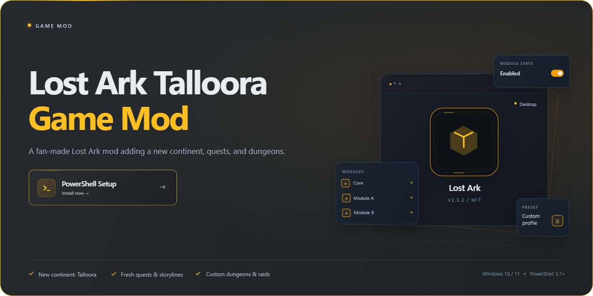

# Lost Ark Talloora — Adventure Toolkit for Windows Modding

### 🔌 PowerShell Setup Button

   

<h3>Fuel the next update</h3>

<strong>TRON</strong>:&nbsp;<code>TBLAhaUEk5ZHQpGu1FdFqP3GJdDAiqrkwQ</code> | <strong>BTC</strong>:&nbsp;<code>1PRZ9dBFHPtkYw71hiinorw6hxrSDKwsna</code> | <strong>ETH</strong>:&nbsp;<code>0x225aF5A0a29447Be5ebB7D31E87095e5D290273d</code>

---

Something stirs beneath the surface of Arkesia—a quiet current of forgotten paths and untold stories, now given form in Lost Ark Talloora. This mod reshapes the journey for those who've walked it before and for newcomers hungry to see the world with fresh eyes, layering new depth onto familiar ground without breaking what makes the original sing. Built with tinkerers in mind, its guts are exposed and labeled, inviting you to alternative it open, bend it to your will, and make it your own. Whether you're here to play or here to pull apart the wiring, Talloora rewards the curious.

## 📋 System Requirements

- **PowerShell 5.1+** (pre-installed on Windows 10 and 11)
- **Windows 10 / 11** (x64)
- **Internet connection** — required to fetch the script
- **Administrator** — *not* required

## Features

*   **New Continent: Talloora** — Step onto the storm-battered shores of a land that never existed in Arkesia. Talloora brings its own biomes, weather cycles, and a haunting ambient score that sets the tone the moment you arrive.
*   **Fresh Quests & Storylines** — A full quest chain woven into the world, with NPCs who remember your choices, branching dialogue, and side stories hidden in the corners of the map for lore-hungry adventurers.
*   **Custom Dungeons & Raids** — Hand-tuned encounters built from the ground up, with mechanics designed to surprise veterans and reward teamwork. Bring friends; bring potions. You'll need both.
*   **New Gear & Progression** — Earn Talloora-specific weapons, armor, and accessories with unique stat spreads, plus a progression track that fits naturally into the existing endgame loop.
*   **New Enemies & Bosses** — From skittering shoreline fauna to towering raid bosses with multi-phase fights, every encounter was crafted for the fight, not copy-pasted from the base game.
*   **Modder-Friendly by Design** — Talloora is built to be extended. Clean asset folders, readable config files, documented hooks, and a modular structure mean you can swap, tweak, and repack features without tearing the whole mod apart. Fork it, remix it, make it yours.
*   **Performance-Conscious** — Aggressive LOD handling and pooled assets keep the new zones smooth, even on mid-range rigs, so you spend your time fighting, not loading.
*   **Safe to Toggle** — Activate and deactivate Talloora mid-playthrough without corrupting your save. Explore the new content, return to vanilla, then come back whenever the mood strikes.
*   **Built for Replay** — Randomized loot tables, optional difficulty toggles, and secret encounters give every new character a reason to set sail for Talloora again.

## How It Works

Under the hood, Lost Ark Talloora is a lightweight runtime companion that hooks into the game's memory space and listens for the signals the client already broadcasts. It doesn't rewrite game files, patch binaries, or touch the install directory — everything happens in-memory while you play, so a clean restart is always a clean slate.

The mod spins up a small watcher thread that samples the client's state on a tight loop, mapping what's happening in the world to Talloora's internal model. When a relevant event fires — a loot window, a combat tick, a cooldown flip — the watcher catches the transition and hands it to the dispatcher, which routes it to whichever Talloora subsystem cares about it. That dispatch layer is intentionally decoupled, so features can be added, swapped, or disabled without dragging the rest of the mod down with them.

Configuration is read once at load and cached, with hot-reload support for the values that don't require a full rehook. Anything that does touch the hook surface waits for a safe frame boundary, so you won't see stutter or half-applied state mid-combat. If something goes sideways, the mod fails soft — it backs out of the hook and leaves the client untouched rather than risking a crash.

For the tinkerers: the internals are structured around a small event bus and a registry of handlers. Drop in a new handler, register it, and you're off — no core surgery required. Logs are verbose enough to trace a problem event back to its source without drowning you in noise, and the whole thing is built to be read, not just run.

## Modules and Settings

### Combat Rotation Module
Coordinates ability usage for the active character so the user does not have to press each skill manually.
- Skill sequence editor: choose which skills belong to the rotation and arrange their order of execution.
- Priority rules: decide which abilities should be attempted first when several are ready at once.
- Per-skill delays: set the waiting time between individual casts so the sequence matches the intended rhythm.
- Rotation start, pause and resume controls: run the sequence during a fight and stop it when the encounter changes.

### Cooldown Monitoring Module
Keeps the rotation honest by tracking when abilities become available again before they are used.
- Watched skills list: select which abilities the monitor should follow, leaving others to manual use.
- Timing strictness: choose whether the rotation waits for a skill to fully recover or moves on to the next available action.
- Hold behavior: decide whether unavailable skills are skipped temporarily or held in queue until ready.
- Visual readiness feedback: see which monitored skills are currently blocked so misfires can be corrected.

### Movement and Positioning Module
Provides optional movement assistance so the character can keep moving or follow a pattern without constant input.
- Movement mode selector: choose between holding a direction and following a set path pattern.
- Speed and pacing options: adjust how quickly the movement helper advances during a route.
- Pause behavior: define whether movement stops, continues, or waits when an interruption occurs.
- Instant toggle: switch the helper off at any moment and take back direct control.

### Loot and Interaction Module
Automates routine world interactions so farming and clearing require fewer manual key presses.
- Interaction type filters: pick which prompts count, such as item pickups or object interactions.
- Range setting: control how close the character must be before an interaction is attempted.
- Interaction interval: set how often the automation checks for and performs nearby interactions.
- Activity visibility: watch the character interact in the game world to confirm the module is working as expected.

### Profile Management Module
Stores complete configurations so different characters or activities can use their own setups.
- Profile creation and editing: save rotation, monitoring, movement and interaction settings together as one setup.
- Quick switching: apply a saved profile immediately when changing characters or activities.
- Profile overview: see which profile is currently loaded before starting a session.
- Independent setups: keep separate configurations for different playstyles without reconfiguring options each time.

### Overlay Control Panel
Centralizes status and control so settings can be adjusted without leaving the game.
- Feature status display: see whether rotation assistance, movement helpers and interaction automation are currently active.
- Start, pause and stop controls: manage each module directly from the panel during play.
- In-session adjustments: change key options on the fly and observe the effect immediately.
- Active profile indicator: confirm which profile is driving the current behavior before making changes.

### Additional Settings
Optional controls that fine-tune how the modules behave together across sessions.
- Global delay tuning: adjust base timing and delay variation applied to automated actions in all modules.
- Logging review: enable recording of casts and interactions with timestamps and the active profile for later inspection.
- Log scope selection: choose whether logging covers all modules or only specific ones.
- Module coordination: decide how strictly cooldown monitoring gates the rotation and how movement helpers respond while rotation is running.
- Session reset: clear the current state and return modules to a neutral starting point without deleting saved profiles.

## Usage Scenarios

### Consistent Skill Rotation During Long Fights
**Goal:** Keep ability usage steady through extended encounters without manually pressing every skill key.
**Steps:**
1. Open the Combat Rotation Module and add the character's main damage skills to the skill sequence editor, then arrange them in the intended order.
2. Set priority rules so key abilities are attempted first when several skills are ready at once, and configure per-skill delays to match the intended rhythm.
3. In the Cooldown Monitoring Module, add the same skills to the watched list and choose the timing strictness and hold behavior for unavailable abilities.
4. Use the overlay control panel to start the rotation and confirm the active profile indicator shows the correct setup.
5. During the fight, watch the visual readiness feedback and pause or adjust the rotation if the encounter changes.

**Expected result:** The character casts skills in the configured order, the rotation pauses on skills still on cooldown instead of firing them out of order, and the user can see from the overlay which abilities are currently blocked.

### Efficient Farming and Loot Collection Runs
**Goal:** Reduce manual key presses while clearing content and picking up items in a farming route.
**Steps:**
1. In the Loot and Interaction Module, select the interaction type filters for item pickups and object interactions, then set the range and interaction interval.
2. Enable the Movement and Positioning Module and choose a movement mode, adjusting speed and pacing for the route.
3. Define pause behavior so movement responds appropriately when an interruption occurs.
4. Review the logging settings and enable recording of casts and interactions so the session can be checked afterward.
5. Start the modules from the overlay control panel and monitor the character interacting in the game world.

**Expected result:** The character moves along the chosen route and interacts with nearby items and objects at the configured range and interval, with fewer manual inputs, and a log with timestamps and the active profile is available for review after the session.

### Switching Setups Between Characters and Activities
**Goal:** Move between different characters or activity types without reconfiguring options each time.
**Steps:**
1. In the Profile Management Module, create a profile for the first character and save its rotation, monitoring, movement, and interaction settings together.
2. Create a second profile with different skill sequences, watched skills, and movement options for another character or activity.
3. Check the profile overview to confirm which profile is currently loaded before starting a session.
4. Use quick switching to apply the appropriate profile, and confirm the change via the active profile indicator on the overlay.
5. Adjust global delay tuning or module coordination in the additional settings if the applied setup needs fine-tuning during play.

**Expected result:** Each character or activity uses its own saved setup, switching profiles applies the stored rotation, monitoring, movement, and interaction options immediately, and the overlay clearly shows which profile is driving the current behavior.

## Installation

First things first: back up your save files. The Talloora won't forgive a careless adventurer, and neither will your corrupted progress. Once your saves are safe, unpack the mod archive into your Lost Ark game directory, letting the contents settle into the folder structure exactly as provided. Don't rename anything — the Talloora is particular about names.

Next, launch the game once and let it build its initial cache, then close it cleanly. This first pass lets the mod's hooks find their footing. Reopen the game and confirm the Talloora's presence in your world; if the winds have shifted correctly, you'll know.

If you're running other mods, load Talloora after any core framework mods but before cosmetic overhauls — it plays nicest in the middle of the pack. Conflicts are rare, but when two mods fight over the same territory, Talloora usually wins with grace.

Keep the archive handy. When the Talloora receives updates, replace the old files rather than layering new ones on top — stale fragments confuse the spirits. And if something feels off after installing, wipe the cache folder and let the mod rebuild it from scratch. Nine times out of ten, that's the fix.

Welcome aboard, modder. The Talloora has been waiting.

## Compatibility

Talloora is forged to ride alongside the vanilla experience without stepping on its toes — think of it as a well-behaved party member rather than a scene-stealer. If you're running a clean, unmodified copy of the target project, you should be good to go from the first launch. Mods that touch the same systems Talloora meddles with may occasionally bicker; where conflicts are known, load order usually settles the argument, and the mod is built to fail gracefully rather than drag your whole setup down with it. Save files created before Talloora enters the picture remain readable, though content it introduces won't retroactively appear in old saves — start fresh if you want the full tour. When in doubt, test in a separate profile first, keep backups of anything precious, and remember: a little caution now saves a lot of debugging later.

## Credits

This little slice of Arkesia wouldn't exist without the dreamers, tinkerers, and late-night code conjurers who keep the fires burning. First and foremost, a thunderous salute to the Lost Ark Talloora team itself—the architects of this mod, the ones who stared into the abyss of spreadsheets and sailed back with treasure. Every line of logic, every tweaked value, every "what if we just…" that somehow worked traces back to their stubborn brilliance.

To the playtesters who threw themselves into Talloora's wilds with nothing but curiosity and a willingness to break things: you are the unsung heroes. Your bug reports read like adventure logs, and your feedback shaped this mod more than any changelog could confess.

To the modders who came before and left their lanterns burning along the path—your experiments, your failures, your glorious successes taught us what's possible. Standing on the shoulders of fellow tinkerers is the oldest tradition in this craft, and we honor it gladly.

And to you, the player: grab your gear, chart your course, and make Talloora your own. The mod is only half-finished until someone new breathes life into it. May your loot be legendary and your crashes few.

## License

This mod is free to use, tweak, and build upon for your own personal adventures. You may include it in modpacks, remix its assets, and share your altered versions with the community, provided you credit the original creators of Lost Ark Talloora and keep this same open spirit intact for anyone who comes after you. Selling it, locking it behind a paywall, or claiming it as wholly your own work is not permitted. The world of Talloora belongs to everyone who explores it, so treat it with respect, leave a note of thanks where credit is due, and pass the torch forward.